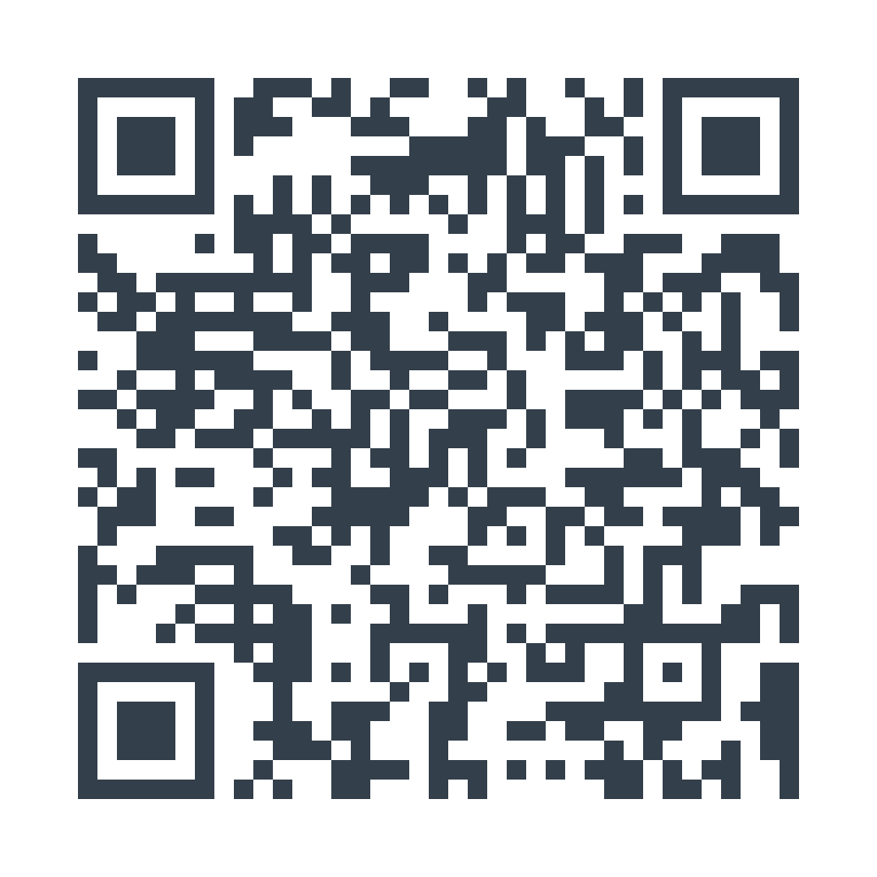

## Where this session sits {#course-map}

::: {.coursemap14}
[Week 1 · Import and audit]{.wk} [1 · Data you can trust]{.cm} [2 · Audit and the AI's code]{.cm}
[Week 2 · Missing data]{.wk} [3 · Why values go missing]{.cm} [4 · Filling gaps you can defend]{.cm}
[Week 3 · Outliers and noise]{.wk .now} [5 · Spike or real event?]{.cm .now} [6 · Smoothing without lying]{.cm}
[Week 4 · Visualization]{.wk} [7 · Trends and distributions]{.cm} [8 · Figures that tell the truth]{.cm}
[Week 5 · Correlation and anomalies]{.wk} [9 · Correlated or driven?]{.cm} [10 · When did it start?]{.cm}
[Week 6 · Hypothesis tests]{.wk} [11 · Did the change work?]{.cm} [12 · Tests on plant data]{.cm}
[Week 7 · Integrated case]{.wk} [13 · Raw file to decision]{.cm} [14 · Defend your decision]{.cm}
:::

::: {.bridge}
Week 2 dealt with values that are missing. Week 3 deals with values that are there but may be wrong. Today: how to tell a fault from a real event.
:::

## Today, minute by minute {#route}

::: {.route}
::: {.seg .act}
[0–10]{.t} **Warm-up** [Your highest peak]{.d}
:::
::: {.seg .concept}
[10–30]{.t} **Concepts** [Three ways to call a value unusual]{.d}
:::
::: {.seg .act}
[30–42]{.t} **Activity 1** [Fault or event?]{.d}
:::
::: {.seg .concept}
[42–55]{.t} **Concepts** [Why a z-score fails on a daily cycle]{.d}
:::
::: {.seg .act}
[55–80]{.t} **Activity 2** [Lab 03, Steps 1 to 3]{.d}
:::
::: {.seg .wrap}
[80–90]{.t} **Debrief** [Exit ticket]{.d}
:::
:::

::: {.route-question}
Question for today: a value is far from the rest. What else must be true before you call it an error?
:::

## Warm-up · Your highest peak {#warmup .activity}

[Pairs · 8 minutes · your homework]{.act-label}

::: {.prompt}
Show your neighbor the highest peak you found in your Lab 02 benzene chart, and say whether you believe it.
:::

::: {.checks3}
::: {.c4}
[1 · When]{.label}
What hour and day? A weekday morning, a weekend night?
:::
::: {.c4}
[2 · Shape]{.label}
One hour alone, or a rise and fall over several hours?
:::
::: {.c4}
[3 · Evidence]{.label}
What would convince you that it is real, or that it is a fault?
:::
:::

[Keep your answer to question 3. Today's lab gives you a second instrument to check against.]{.note-line}

::: {.selfstudy}
Studying alone: write down your answers to the three questions.
:::

## Two ways to measure spread {#spread}

Seven hours of benzene, µg/m³. One of them is a fault: 4.1 · 4.4 · 4.0 · 4.6 · 4.3 · **21.0** · 4.2

::: {.beforeafter}
::: {}
[Mean and standard deviation]{.label}
Mean 6.66, σ 6.33 (pandas `.std()`). The one bad hour pulls both up.

The 21.0 is (21.0 − 6.66) / 6.33 = **2.3 σ** from the mean. Below 3: not flagged.
:::
::: {}
[Median and MAD]{.label}
Median 4.3, the middle value once sorted. **MAD** is the median of the distances from the median: 0.2, 0.1, 0.3, 0.3, 0, 16.7, 0.1, so MAD = 0.2.

Scaled MAD = 1.4826 × 0.2 = 0.30 µg/m³. The factor makes it equal to σ for normally distributed data. The 21.0 is (21.0 − 4.3) / 0.30 ≈ **56 scaled MADs** away. Flagged.
:::
:::

[One bad value can hide by inflating σ. The median and the MAD barely move, which is why the Hampel filter on the next slide uses them.]{.note-line}

## Three ways to call a value unusual {#rules}

::: {.why3}
::: {.w}
[Far from the whole record]{.label}
**z-score.** Distance from the mean, in standard deviations (σ). Flag if more than 3σ.
[Ignores time: a normal rush hour can be "far".]{.eff}
:::
::: {.w}
[Far from its neighbors]{.label}
**Hampel filter.** Distance from the median of the 7 nearby hours, in scaled MADs (1.4826 × MAD, equal to σ for normal data). Flag if more than 3.
[Follows the daily cycle; also flags sharp real changes.]{.eff}
:::
::: {.w .hard}
[Not seen by a second measurement]{.label}
**Physical check.** Does another instrument, a mass balance or a lab sample agree?
[The only one that asks whether something happened.]{.eff}
:::
:::

[The first two ask "is it unusual?". Only the third asks "is it real?". A real event can be unusual; a fault can look ordinary.]{.note-line}

## Activity 1 · Fault or event? {#act1 .activity data-hold="true"}

[Pairs · 12 minutes · no computer needed]{.act-label}

```{=html}
<div class="spk" id="spk">
  <div class="sm-controls">
    <div class="sm-mode" role="group" aria-label="What to show">
      <button type="button" data-v="sensor" aria-pressed="false">Second sensor</button>
      <button type="button" data-v="z" aria-pressed="false">z = 3 line</button>
      <button type="button" data-v="reveal" aria-pressed="false">Reveal</button>
    </div>
  </div>
  <svg id="spk-plot" viewBox="0 0 1160 330" role="img" aria-label="Four days of benzene from Lab 03, Demo A, with seven numbered hours to judge as fault or real event"></svg>
  <p class="sm-readout" id="spk-out" aria-live="polite">Judge each numbered hour first. Then add the second sensor, then the z = 3 line, then reveal.</p>
</div>
<script>
(function () {
  const root = document.getElementById('spk'); if (!root) return;
  root.addEventListener('click', (e) => e.stopPropagation());
  // Lab 03 Demo A, 27 to 30 April 2004: benzene as recorded (three hours are faults), the sensor scaled to benzene.
  const Y = [2.2,1.7,1.6,1.5,2.5,3.3,8.9,23.4,23.8,7.9,8.2,8.8,14.6,18,12,14.8,12.5,15.5,17.7,21.6,18.9,12.5,8.8,10.9,8,4.4,2.8,2.7,2.2,2.5,7.5,30.4,22,24.7,18.4,16.8,43.5,15.7,21.9,20.8,16.2,19.8,28.9,28.3,24.9,13.1,8.6,9.5,7.8,5.2,2.8,2.3,2.5,4.4,9.4,29.8,36.2,18,10.9,9,14.4,22.3,20.9,23.1,21.2,24.8,28.6,32.6,19.2,16.3,13.7,13.6,11.1,7.6,5.9,5,4,4.5,9.3,18.3,19.9,16.6,12.6,12.9,0.1,17.4,15.4,16.7,18,19.2,21,26.9,19.5,0.1,14.6,13.7];
  const SN = [3.4,2.4,3,2.9,4.7,5.3,10.7,21.8,20.2,9.4,9,9.2,12.3,14.3,10.7,12.6,11.4,13.3,16.2,18.2,15.6,11.6,9.5,11,8.8,6,4.3,4.4,3.3,3.3,8.1,26.7,21,23.9,20.5,17.5,15.3,16,19,18.2,16.5,21.2,26.3,27.6,25.3,14.8,11.4,13.4,10.9,8.5,5.2,4.4,4.2,6.1,10,26.2,29,18.8,11.7,8.5,12,18.5,20.2,22.9,21.2,23,26,28.7,22,18.5,16.9,19.5,15.6,12.3,10,8.8,7.8,7.4,13.1,20.2,18.7,18,16.1,16.6,17.5,18.5,16,18.5,22,21,20.8,24.9,19.9,17.5,17.7,18.7];
  const MARKS = [[7, 0], [8, 0], [36, 1], [55, 0], [56, 0], [84, 1], [93, 1]];   // [hour, fault]
  const ZLINE = 32.05;                                                         // mean + 3σ of the 14-day record
  const on = { sensor: false, z: false, reveal: false };
  const N = Y.length, W = 1160, H = 330, L = 64, R = 16, T = 14, B = 44, top = 48;
  const X = (k) => L + (k / (N - 1)) * (W - L - R), V = (v) => T + (1 - v / top) * (H - T - B);
  const path = (a) => a.map((v, k) => (k ? 'L' : 'M') + X(k).toFixed(1) + ',' + V(v).toFixed(1)).join('');
  function draw() {
    let g = '';
    for (const v of [0, 10, 20, 30, 40]) g += `<line x1="${L}" x2="${W - R}" y1="${V(v)}" y2="${V(v)}" stroke="#B9C1C6"/><text x="${L - 10}" y="${V(v) + 6}" text-anchor="end" font-size="17" fill="#333F4A">${v}</text>`;
    for (let d = 0; d < 4; d++) g += `<line x1="${X(d * 24)}" x2="${X(d * 24)}" y1="${H - B}" y2="${H - B + 6}" stroke="#333F4A"/><text x="${X(d * 24 + 12)}" y="${H - 14}" text-anchor="middle" font-size="17" fill="#333F4A">${27 + d} April</text>`;
    g += `<text transform="translate(18 ${(T + H - B) / 2}) rotate(-90)" text-anchor="middle" font-size="16" fill="#66727C">benzene, µg/m³</text>`;
    g += `<line x1="${L}" x2="${L}" y1="${T}" y2="${H - B}" stroke="#333F4A" stroke-width="1.5"/><line x1="${L}" x2="${W - R}" y1="${H - B}" y2="${H - B}" stroke="#333F4A" stroke-width="1.5"/>`;
    if (on.z) g += `<line x1="${L}" x2="${W - R}" y1="${V(ZLINE)}" y2="${V(ZLINE)}" stroke="#E29A2D" stroke-width="2" stroke-dasharray="8 5"/><text x="${W - R}" y="${V(ZLINE) - 8}" text-anchor="end" font-size="16" fill="#9a5f10">z = 3 (mean + 3σ of the two weeks)</text>`;
    if (on.sensor) g += `<path d="${path(SN)}" fill="none" stroke="#333F4A" stroke-width="1.8" stroke-dasharray="5 4" opacity=".8"/>`;
    g += `<path d="${path(Y)}" fill="none" stroke="#0F6E6B" stroke-width="2"/>`;
    MARKS.forEach(([k, f], n) => {
      const fill = on.reveal ? (f ? '#E29A2D' : '#fff') : '#fff', stroke = on.reveal ? (f ? '#1C242B' : '#0F6E6B') : '#333F4A';
      g += `<circle cx="${X(k)}" cy="${V(Y[k])}" r="13" fill="${fill}" stroke="${stroke}" stroke-width="2"/><text x="${X(k)}" y="${V(Y[k]) + 5}" text-anchor="middle" font-size="15" font-weight="700" fill="#1C242B">${n + 1}</text>`;
    });
    document.getElementById('spk-plot').innerHTML = g;
    root.querySelectorAll('[data-v]').forEach((b) => b.setAttribute('aria-pressed', on[b.dataset.v]));
    if (on.reveal) document.getElementById('spk-out').innerHTML = '<b>Faults: 3, 6, 7.</b> Real: 1, 2, 4, 5. The z = 3 line flags 3 (a fault) and 5 (a real rush hour), and misses the two drops to 0.1.';
  }
  root.querySelectorAll('[data-v]').forEach((b) => b.addEventListener('click', () => { on[b.dataset.v] = !on[b.dataset.v]; draw(); }));
  draw();
})();
</script>
```

::: {.prompt .small}
For each numbered hour, decide: a fault or a real event? Then switch on the second sensor. Did any answer change?
:::

## Why a z-score fails on a daily cycle {#zfail}

::: {.beforeafter}
::: {}
[What the z-score sees]{.label}
One number for the whole two weeks: mean 10.5, standard deviation 7.2. Anything above 32.1 is "unusual". A busy morning reaches that. A drop to 0.1 at noon is well inside the range.
:::
::: {}
[What it misses]{.label}
At noon benzene is normally 10 to 20. A value of 0.1 is unusual for that hour, not for the record. The faults also inflate the standard deviation, which makes the rule even less sensitive.
:::
:::

::: {.calc}
In Demo A the z-score flags 4 hours: **2 faults and 2 real rush hours**. It misses 6 of the 8 faults.
:::

[Use a rule that knows the time of day (Hampel), and check flagged hours against a second measurement before you remove anything.]{.note-line}

## Activity 2 · Lab 03, Steps 1 to 3 {#act2 .activity}

[Individual · 25 minutes · laptop or phone]{.act-label}

1. Open **Lab 03** and enter your name and student ID. Press **My data set**.
2. Step 2: look at your record, first alone, then with the second sensor.
3. Step 3: judge all 15 numbered hours as fault or real, and write what you looked at.
4. Do not run the rules yet. Download your study in Step 10 to keep your work.

[Open Lab 03](../labs/spikes.html){.lab-button target="_blank"}

::: {.selfstudy}
Studying alone: do Steps 1 to 3, then download your study in Step 10.
:::

## Debrief {#debrief}

::: {.debrief-q}
[Which numbered hour changed your mind when you switched on the second sensor?]{.dq}
[Find a fault in your file that sits inside the normal daily range. Which rule could catch it?]{.dq}
[When would the second-sensor check fail?]{.dq}
:::

## Exit ticket · 5 minutes {#exit .activity}

[Exit ticket and feedback · alone · 5 minutes · anonymous]{.act-label}

:::: {.columns}
::: {.column width="64%"}
::: {.prompt}
A flow reading jumps to twice its normal value for one hour. Name two checks you would make before calling it a fault, and what each would show.
:::

Scan the code or open the link. The same form asks three short questions about today: pace, confidence, and whether the lab worked on your device.

No name or student ID is recorded. Wait for **"Response received."**
:::
::: {.column width="32%" .qr-col}
{.qr fig-alt="QR code for the Session 5 exit ticket and feedback form"}

[Open the Session 5 form](exit.html?s=5){target="_blank"}
:::
::::

## Next session {#next}

::: {.beforeafter}
::: {}
[Session 6 · Smoothing without lying]{.label}
What a rolling mean does to peaks and timing, and how to show a calmer chart without hiding the events.
:::
::: {}
[Before you come]{.label}
Download your file in Lab 03, Step 5. Ask an AI assistant for code that reports the three numbers there, and read the code before you run it.
:::
:::

[Lab 03 is due after Session 6. Submit the study file on myCourseVille.]{.note-line}
